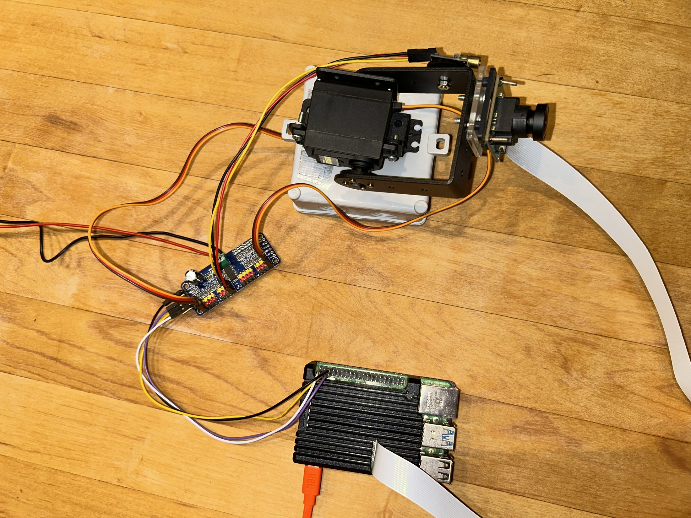
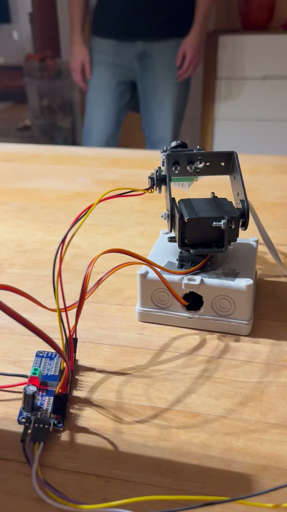
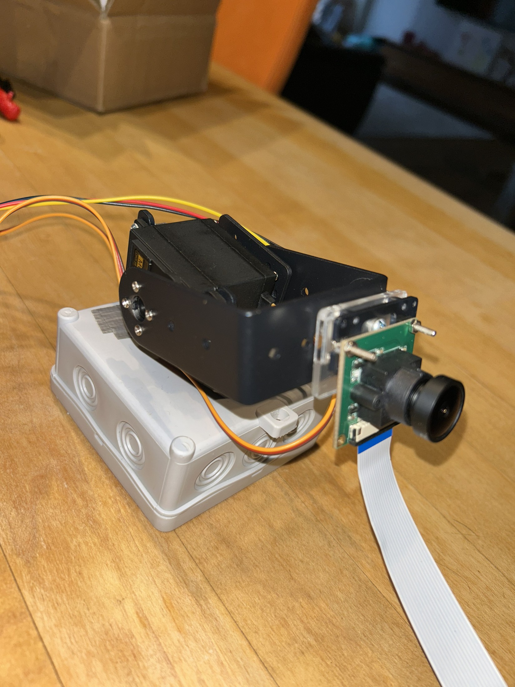
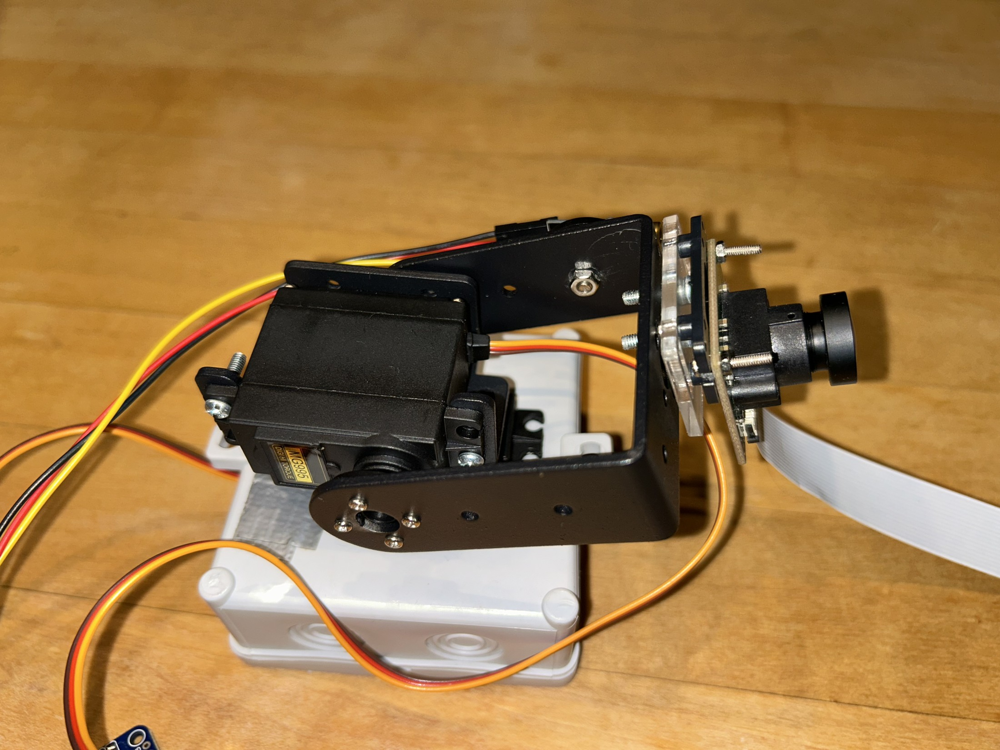
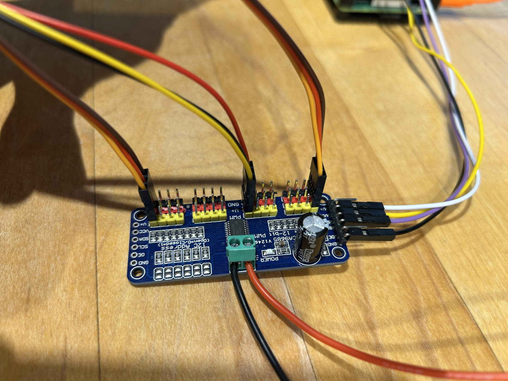
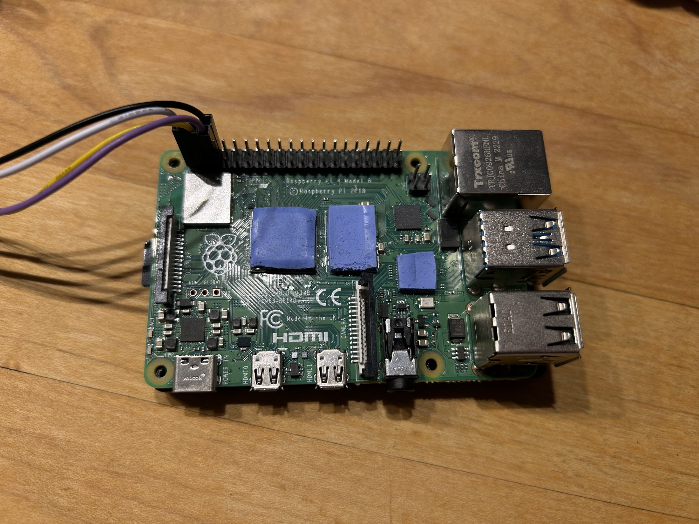
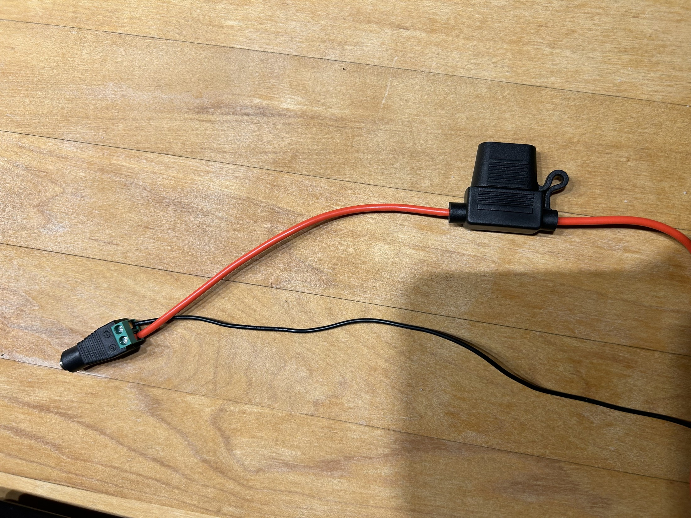

# Raspberry Pi Face Tracker

A small camera system that detects a face and automatically turns to keep
it near the centre of the image.

The project combines a Raspberry Pi, a camera, and a two-axis pan/tilt mount.
A simple browser interface shows the live camera view and provides controls
for automatic tracking and manual movement.

## Main features

- Live camera stream with face detection.
- Automatic horizontal and vertical camera movement.
- Browser controls for tracking, movement, and speed.

## Current status

Working prototype. We are refining the tracking behaviour and the interface.
This repository currently contains the project overview; source code and
setup instructions will follow.

# Raspberry Pi Face Tracker

A camera that turns to follow a face. A side project by Felix and Artur.

## The idea

We wanted to build a small camera mount that could follow a person without
someone having to turn it by hand. A Raspberry Pi reads the camera image,
finds a face, and adjusts two motors to bring the face towards the centre
of the picture.

The project gave us a practical reason to work on the mechanical assembly,
power supply, and camera control together. We started with individual camera
and motor tests before connecting them into one working prototype.

## Demonstration

The recordings show an indoor test on 7 June 2026. One video shows the
mount from outside; the other records the camera image and controls in the
browser. They show the same type of demonstration from two viewpoints,
but their playback is not synchronised automatically.

### Camera mount in motion

[Open the hardware demonstration](site/assets/videos/hardware-demo.mp4), about 31 seconds.
The camera and its two motors are visible while a person moves in front of it.

### Live view and controls

[Open the interface recording](site/assets/videos/tracking-interface.mp4), about 54 seconds.
The green box marks the detected face. The cross in the image marks the
target position. Measurements below the picture show the current tracking
error and the requested motor positions.

These are bench demonstrations, not controlled measurements of tracking
accuracy or response time.

## How it works

1. The camera sends its image to the Raspberry Pi.
2. The Pi finds a face and compares its position with the centre of the image.
3. The motor controller receives a correction for the horizontal and vertical axes.
4. The camera moves, and the Pi checks the next image.

A larger position error produces a faster correction, up to the selected
speed limit. Movement slows as the face approaches the centre. This is
proportional control, with a little smoothing to reduce small, rapid movements.

The camera processing and motor control run on the Pi. The laptop displays
the browser interface. We can start or stop tracking, change the speed, or
move the mount manually from there.

We use YuNet, a small neural-network face detector, as the default. An older
OpenCV Haar detector is also available for comparison. Both find the position
of a face in the image.

## Hardware

| Part | Quantity | What we use it for |
| --- | --- | --- |
| Raspberry Pi 4B | 1 | Camera processing, motor commands, and the browser interface |
| Pi-compatible CSI camera, OV5647 sensor | 1 | Capturing the scene; the sensor has a 5 MP maximum resolution |
| MG995 servo motor | 2 | One turns the camera horizontally; the other tilts it vertically |
| Metal pan/tilt bracket | 1 | Holding the motors and camera in a two-axis assembly |
| PCA9685 servo controller | 1 | Sending the control signals to both motors |
| External 5 V, 5 A power supply | 1 | Supplying the servo motors separately from the Pi |
| Raspberry Pi power supply and microSD card | 1 each | Powering and running the Pi |
| Jumper leads, power wires, barrel adapter, and inline fuse holder | Assorted | Connecting the controller and power supply |
| Small enclosure/base | 1 | Supporting the camera mount on the workbench |

The wider parts inventory also includes a VL53L1X distance sensor and laser
modules. They are not used for the face-tracking demonstration. The laser
stays disconnected during tests with people.

## A closer look at the build

### Camera and mount

The bracket carries both motors and the camera. We fixed the assembly to a
small base and kept enough slack in the camera ribbon cable for it to move.

### Controller and Raspberry Pi

The PCA9685 board sits between the Pi and the motors. The motors have their
own supply, while the control circuit shares a common ground with the Pi.

### Power connection

The power lead includes an inline fuse holder. We check the supply voltage,
polarity, and wiring before connecting the motors. The motors are powered
from the external supply, not from the Pi's power pins.

## What took some adjustment

Getting a face detection on the screen was only part of the job. The motor
directions also had to match the way we assembled the bracket. During the
first tracking test, both axes corrected in the wrong direction and moved
the face further from the centre. Reversing both directions corrected this.

We also adjusted the movement speed and the small area around the image
centre where the motors do not need to correct. A very cautious setting was
too slow to follow movement, while stronger corrections could overshoot.
The browser controls made those adjustments easier to test.

## Current state

The prototype has a colour camera stream, working face detection, and
movement on both axes. The interface includes manual movement, detector
selection, speed settings, and measurements underneath the image.
Tracking starts switched off.

Earlier camera checks on the Pi ran at about 20 frames per second with a
640 by 480 output image. That is a camera-processing figure, not a measured
mechanical response time. We have not yet carried out a repeatable test of
tracking accuracy, delay, or performance in different lighting.

The mounting and wiring are still at a prototype stage. We are documenting
the build before adding source code and detailed setup instructions to
this repository.

## People and references

Built by [Felix](https://github.com/Felix561) and
[Artur](https://github.com/Artur-04) as part of
[Side projects](https://github.com/Felix-Artur-Sideprojects).

The prototype uses [OpenCV](https://opencv.org/), the
[YuNet face detector](https://github.com/opencv/opencv_zoo/tree/main/models/face_detection_yunet),
and [Picamera2](https://github.com/raspberrypi/picamera2).
