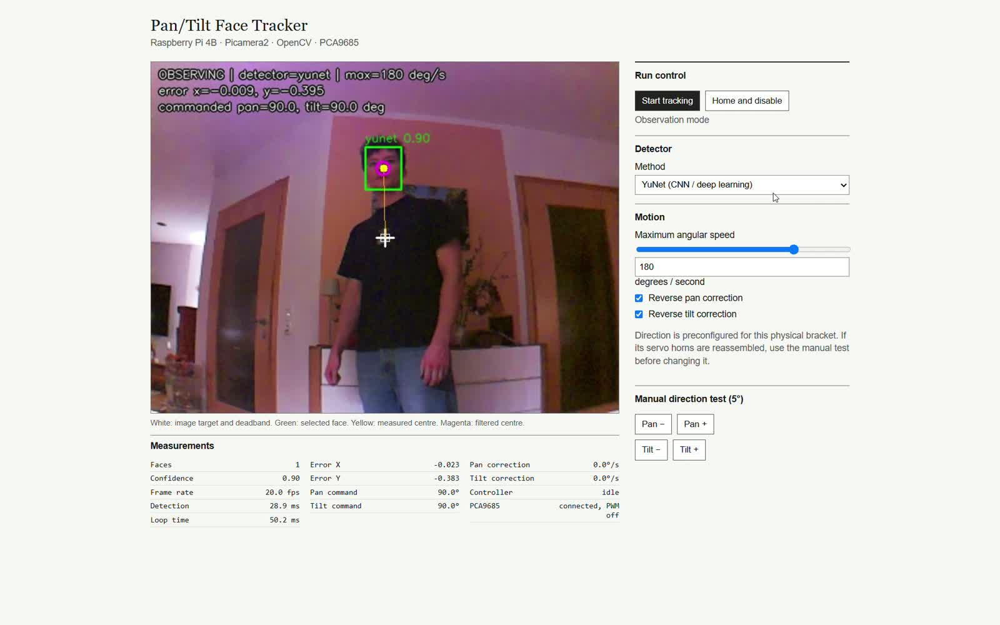

# Raspberry Pi Face Tracker

A camera that turns to follow a face. A side project by Felix and Artur.

## The idea

We wanted to build a small camera mount that could follow a person without
someone having to turn it by hand. A Raspberry Pi reads the camera image,
finds a face, and adjusts two motors to bring the face towards the centre
of the picture.

The project gave us a practical reason to work on the mechanical assembly,
power supply, and camera control together. We started with individual camera
and motor tests before connecting them into one working prototype.

## Demonstration

The recordings show an indoor test on 7 November 2026. One video shows the
mount from outside; the other records the camera image and controls in the
browser. They show the same type of demonstration from two viewpoints,
but their playback is not synchronised automatically.

### Camera mount in motion

[Open the hardware demonstration](site/assets/videos/hardware-demo.mp4), about 31 seconds.
The camera and its two motors are visible while a person moves in front of it.

### Live view and controls

[Open the interface recording](site/assets/videos/tracking-interface.mp4), about 54 seconds.
The green box marks the detected face. The cross in the image marks the
target position. Measurements below the picture show the current tracking
error and the requested motor positions.

Click either preview to open its MP4 file. For playback with both videos
on one page, open [the project page](site/index.html) from a local copy
of this repository. GitHub shows the HTML file as source; the page is not
currently published.

<!-- GitHub inline video playback requires an uploaded video attachment URL.
The relative MP4 links above provide a fallback, not an inline player.
When preparing the GitHub README later, upload each video through GitHub's
Markdown attachment interface and place its returned URL on a separate line.
Do not use a made-up attachment URL or an HTML video tag as a substitute.
On GitHub Free, each video attachment must be under 10 MB. The hardware
video is currently about 13 MB and needs a smaller copy for that upload.
No attachment upload has been performed for this local draft. -->

These recordings document the prototype in use. We have not measured
tracking accuracy or the complete delay from camera exposure to motor movement.

## How it works

1. The camera sends its image to the Raspberry Pi.
2. The Pi finds a face and compares its position with the centre of the image.
3. The motor controller receives a correction for the horizontal and vertical axes.
4. The camera moves, and the Pi checks the next image.

A larger position error produces a faster correction, up to the selected
speed limit. Movement slows as the face approaches the centre. This is
proportional control, with a little smoothing to reduce small, rapid movements.

The Raspberry Pi captures the camera images, runs the face detector, and
calculates the motor corrections. It also runs the web server that sends
the live video and interface to the laptop.

On the laptop, a normal web browser displays the video and runs the
interface's buttons and controls. When we change a setting, the browser
sends the command back to the Pi. The face-detection model runs on the Pi.

## Two ways to detect a face

We tried both a classical machine-learning detector and a small deep-learning
model. Both are available in the browser controls, and we briefly showed
the deep-learning option in the demonstration. YuNet is the default in the
current application. We use pretrained detectors; we did not train our own.

| | Haar cascade | YuNet |
| --- | --- | --- |
| Approach | Classical machine learning: a cascade of trained classifiers using Haar-like brightness patterns | Deep learning: a small convolutional neural network that learns image features during training |
| Input in our application | A reduced greyscale image | A reduced colour image |
| Result used for tracking | A rectangle around a face | A rectangle around a face and a detection confidence |
| Role in the project | Our earlier approach, kept for comparison | Our current default |
| Model parameters | Cascade stages and feature thresholds; a CNN parameter count would not be a useful direct comparison | 53,104 weights and bias values in the exported model |
| Where it runs | Raspberry Pi CPU | Raspberry Pi CPU |

Both detectors locate faces. They do not identify who a person is. The motor
controller uses the detected face position in the same way with either option.
We have not yet compared their accuracy and speed in a controlled test with
the same recordings and settings.

### Model size and speed

The YuNet model is `face_detection_yunet_2023mar.onnx`, evaluated through
OpenCV on the Raspberry Pi 4B CPU. Our setup uses no external TPU or other
AI accelerator. Its file is 232,589 bytes, about 227 KiB, with FP32 weights.
Counting the convolution weights and biases in this exported file gives
53,104 parameters. Eight additional floating-point values are resize
constants and are excluded from that count.

The camera output is 640 by 480 pixels. Face detection uses a smaller
320 by 240 image, which reduces the amount of processing. In one recorded
YuNet run, the interface showed 28.9 ms for detection and 50.2 ms for the
processing loop, at about 20 frames per second. The detection figure includes
image resizing and processing around the model; it is not a measurement of
neural-network inference alone.

The small network and reduced input size made CPU processing practical for
our indoor demonstration. Mechanical movement, image capture, and the video
stream add their own delays. We have not measured the full response time.

## Hardware

| Part | Quantity | What we use it for |
| --- | --- | --- |
| Raspberry Pi 4B | 1 | Camera processing, motor commands, and the browser interface |
| Pi-compatible CSI camera, OV5647 sensor | 1 | Capturing the scene; the sensor has a 5 MP maximum resolution |
| MG995 servo motor | 2 | One turns the camera horizontally; the other tilts it vertically |
| Metal pan/tilt bracket | 1 | Holding the motors and camera in a two-axis assembly |
| PCA9685 servo controller | 1 | Sending the control signals to both motors |
| External 5 V, 5 A power supply | 1 | Supplying the servo motors separately from the Pi |
| Raspberry Pi power supply and microSD card | 1 each | Powering and running the Pi |
| Jumper leads, power wires, barrel adapter, and inline fuse holder | Assorted | Connecting the controller and power supply |
| Small enclosure/base | 1 | Supporting the camera mount on the workbench |

The wider parts inventory also includes a VL53L1X distance sensor and laser
modules. They are not used for the face-tracking demonstration. The laser
stays disconnected during tests with people.

## A closer look at the build

### Camera and mount

The bracket carries both motors and the camera. We fixed the assembly to a
small base and kept enough slack in the camera ribbon cable for it to move.

### Controller and Raspberry Pi

The PCA9685 board sits between the Pi and the motors. The motors have their
own supply, while the control circuit shares a common ground with the Pi.

### Power connection

The power lead includes an inline fuse holder. We check the supply voltage,
polarity, and wiring before connecting the motors. The motors are powered
from the external supply, not from the Pi's power pins.

## What took some adjustment

Getting a face detection on the screen was only part of the job. The motor
directions also had to match the way we assembled the bracket. During the
first tracking test, both axes corrected in the wrong direction and moved
the face further from the centre. Reversing both directions corrected this.

We also adjusted the movement speed and the small area around the image
centre where the motors do not need to correct. A very cautious setting was
too slow to follow movement, while stronger corrections could overshoot.
The browser controls made those adjustments easier to test.

## Current state

The prototype has a colour camera stream, working face detection, and
movement on both axes. The interface includes manual movement, detector
selection, speed settings, and measurements underneath the image.
Tracking starts switched off.

The indoor demonstration worked well enough to follow a person moving in
front of the camera. Repeatable tests of tracking accuracy and performance
in different lighting are still pending.

The mounting and wiring are still at a prototype stage. We are documenting
the build before adding source code and detailed setup instructions to
this repository.

## People and references

Built by [Felix](https://github.com/Felix561) and
[Artur](https://github.com/Artur-04) as part of
[Side projects](https://github.com/Felix-Artur-Sideprojects).

The prototype uses [OpenCV](https://opencv.org/), the
[YuNet face detector](https://github.com/opencv/opencv_zoo/tree/main/models/face_detection_yunet),
and [Picamera2](https://github.com/raspberrypi/picamera2).

## License

The original application and website code are available under the [MIT license](LICENSE).
See [third-party notices](THIRD_PARTY_NOTICES.md) for YuNet, the Haar cascade,
and the Python dependencies. The demo photos and videos are outside the code license.
